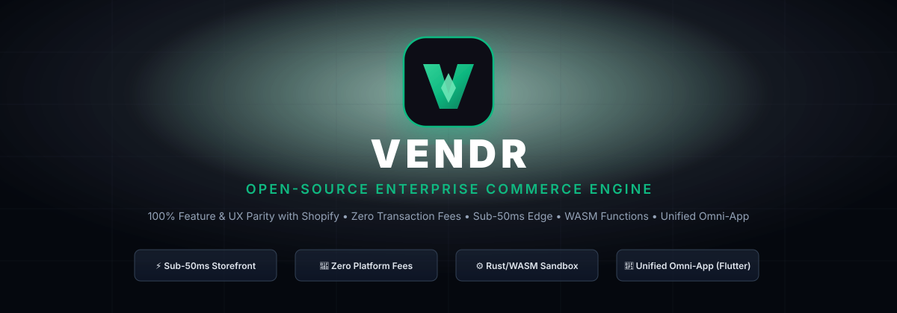

<p align="center">
  
</p>

<p align="center">
  <strong>Open Shopify — The Open-Source, Self-Hosted Enterprise Commerce Engine with 100% Shopify Parity.</strong><br>
  Zero Transaction Fees • Sub-50ms Global Edge • Sandboxed Pure WASM Functions • OmniShop Multi-Platform Client (iOS, Android, Windows, macOS, Linux)
</p>

<p align="center">
  <a href="https://github.com/abdulaaly/Open_Shopify/actions"></a>
  <a href="https://nextjs.org"></a>
  <a href="https://fastify.dev"></a>
  <a href="https://webassembly.org"></a>
  <a href="https://flutter.dev"></a>
  <a href="./LICENSE"></a>
</p>

---

## ⚡ Why Open Shopify?

Shopify is the gold standard of merchant ergonomics—but enterprise brands are penalised by **0.5%–2.0% transaction rake fees**, vendor lock-in, closed runtime constraints, and the $27,600/year Shopify Plus paywall.

**Open Shopify** is architected from first principles to deliver:
1. **Zero Transaction Fees:** Settle payments directly with Stripe, PayPal, or Cash on Delivery (COD). No platform cuts on your GMV.
2. **Sub-50ms Global Edge:** Lightweight Fastify + GraphQL Storefront core delivering blazing-fast sub-100ms LCP and instant cart mutations.
3. **Shopify Functions Parity (WASM):** Execute custom discount rules, cart transformations, and checkout validation in pure, sandboxed WebAssembly with deterministic `<5ms` execution budgets (benchmarked at **0.54ms**).
4. **Online Store 2.0 & Liquid Theme Engine:** Full support for `templates/*.json`, modular `sections/*.liquid` with ``, and a live **Split-Screen Drag-and-Drop Theme Customizer**.
5. **OmniShop Unified POS & Mobile Client (`apps/omnishop`):** Single clean architecture Flutter codebase for **iOS, Android, Windows, macOS, and Linux**. All platforms connect to each other in real-time through a **unified Open Shopify merchant/staff account**, synchronizing active POS shifts, inventory scans, and order notifications.

---

## 📊 Feature & Architecture Comparison

| Capability | Shopify (Plus / Advanced) | Open Shopify (`open-shopify`) |
| :--- | :--- | :--- |
| **Transaction Fees** | 0.5% – 2.0% (plus third-party fees) | **0.0% (Zero platform fees)** |
| **Self-Hosting / Data Sovereignty** | ❌ Proprietary Cloud Only | **✅ 1-Click Docker Compose & Kubernetes** |
| **Multi-Tenancy Isolation** | Proprietary SaaS | **✅ PostgreSQL Row-Level Security (RLS)** |
| **Backend Extensibility** | Shopify Functions (Plus locked) | **✅ Native Sandboxed WASM Functions Engine** |
| **Storefront Architecture** | Liquid + Headless Oxygen | **✅ Next.js 15 App Router + Liquid Engine** |
| **Theme Customizer** | Online Store 2.0 Theme Editor | **✅ Live Split-Screen Section Customizer** |
| **Unified POS & Mobile Client** | Fragmented separate apps | **✅ OmniShop Flutter (iOS, Android, Mac, Win, Linux)** |
| **Cross-Platform Account Sync** | Disjointed logins | **✅ Unified Account Authentication & Real-Time Sync** |
| **Edge Response Latency** | ~200ms – 600ms | **⚡ Sub-50ms Fastify Edge Core** |
| **Native AI Merchandising** | Add-on App Store subscriptions | **✅ Built-in Model Context Protocol (MCP)** |

---

## 🏗️ Architecture & Monorepo Topology

```
Open_Shopify/
├── apps/
│   ├── api/               # Fastify Core Multi-Tenant Backend (GraphQL + REST + Webhooks)
│   ├── admin/             # Polaris-grade Merchant Admin Dashboard (Next.js 15)
│   ├── storefront/        # High-Performance Default Storefront Theme (Next.js 15)
│   ├── theme-editor/      # Split-Screen Visual Storefront Customizer (OS 2.0)
│   ├── web-marketing/     # Enterprise Public Marketing & ROI Calculator (Next.js 15)
│   └── omnishop/          # OmniShop Unified POS & Client (iOS, Android, Windows, macOS, Linux)
│       ├── android/       # Google Android runner
│       ├── ios/           # Apple iOS runner
│       ├── linux/         # Linux GTK 3 runner
│       ├── macos/         # macOS Cocoa runner
│       ├── windows/       # Windows Win32 runner
│       └── lib/           # AccountSessionService, POS scanner, Store Pulse
├── packages/
│   ├── database/          # Multi-Tenant PostgreSQL Prisma schema with RLS
│   ├── types/             # Shared TypeScript schemas & GraphQL types
│   ├── ui/                # Polaris-grade React 19 UI component library
│   └── wasm-engine/       # Sub-millisecond pure WebAssembly runner
├── docs/
│   ├── ARCHITECTURE.md    # Deep technical architectural design
│   ├── API_SPEC.md        # GraphQL Storefront, Admin & Webhook specifications
│   ├── DECISIONS.md       # Architecture Decision Records (ADRs)
│   └── AUDIT_VS_SHOPIFY.md# Live adversarial benchmark against shopify.com
├── k8s/                   # Production Kubernetes Helm/manifests
└── docker-compose.yml     # 1-Click production self-hosting stack
```

---

## 📱 OmniShop: Cross-Platform Account Sync

OmniShop runs natively on **iOS, Android, Windows, macOS, and Linux**. All instances connect via a single merchant/staff account:
- **Instant QR Pairing:** Scan a QR code from any mobile device to immediately link it to the store's central account.
- **Real-Time Cross-Device Sync:** POS checkout on Windows updates inventory in real time on mobile iOS and Android barcode scanners.
- **Role-Based Device Permissions:** Grant Cashier access to POS terminals while retaining Admin authority on desktop and mobile.

---

## 🚀 Quick Start (Self-Hosted)

### Prerequisites
- Node.js 20+
- pnpm 12+
- Docker & Docker Compose

### 1-Click Boot via Docker Compose
```bash
# Clone the repository
git clone https://github.com/abdulaaly/Open_Shopify.git
cd Open_Shopify

# Start all microservices, database, and cache
docker compose up -d
```

### Access Endpoints
- **Marketing & ROI Calculator:** `http://localhost:3003`
- **Merchant Admin:** `http://localhost:3001`
- **Online Storefront:** `http://localhost:3000`
- **Visual Theme Editor:** `http://localhost:3002`
- **Core Fastify API:** `http://localhost:4000`

---

## 📜 License & Governance
Released under the **Apache License 2.0**. You are free to self-host, customize, rebrand, and scale Open Shopify for commercial and personal commerce operations with zero licensing royalties.
