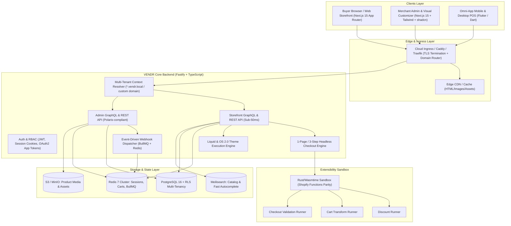
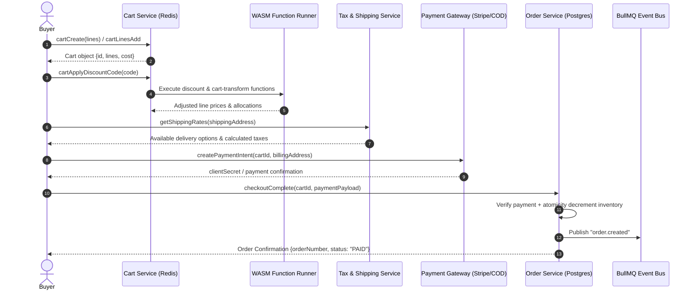

# Open Shopify Architecture Specification

## 1. Executive Summary & System Constitution
**Open Shopify** is an open-source, enterprise-grade, multi-tenant digital commerce engine designed to achieve 100% feature and developer ergonomics parity with Shopify while offering:
- **Zero Transaction Fees:** Self-hosted infrastructure with direct payment processor settlement.
- **Sub-50ms Global Response Time:** Edge-cached GraphQL Storefront and lightweight Fastify backend core.
- **Native WebAssembly Functions:** High-performance sandboxed plugin execution (Rust/WASM) for custom business logic, cart transformations, and discount calculation.
- **True Multi-Tenancy:** Single cluster supporting thousands of isolated merchant stores via PostgreSQL Row-Level Security (RLS) and dynamic domain routing.
- **Universal Omni-Platform Clients:** Next.js 15 Web Merchant Admin + Liquid Theme Engine alongside **OmniShop**, a unified Flutter Mobile (iOS/Android) and Desktop (Windows/macOS/Linux) POS & management application connected via unified account authentication.

---

## 2. High-Level System Architecture Diagram



---

## 3. Multi-Tenancy & Data Isolation Model

VENDR employs **Row-Level Security (RLS)** in PostgreSQL paired with dynamic tenant scoping in application middleware.

### 3.1 Tenant Identification Strategy
1. **Subdomain Resolution:** Requests to `acme-store.vendr.local` resolve to tenant slug `acme-store`.
2. **Custom Domain Resolution:** Requests to `store.brand.com` are queried against the `TenantDomain` mapping table with Redis LRU caching.
3. **Admin Token Context:** Store staff and API access tokens carry explicit claims:
   ```json
   {
     "sub": "usr_948194",
     "tenant_id": "ten_01HXYZ789",
     "role": "MERCHANT_ADMIN",
     "scopes": ["read_products", "write_orders"]
   }
   ```

### 3.2 Database Isolation Architecture
Every database table containing tenant-scoped data inherits the `tenant_id` foreign key. Fastify sets the local tenant context on every request transaction:
```sql
-- On each database connection acquisition:
SET LOCAL app.current_tenant_id = 'ten_01HXYZ789';

-- PostgreSQL RLS Policy:
CREATE POLICY tenant_isolation_policy ON products
  FOR ALL
  USING (tenant_id = NULLIF(current_setting('app.current_tenant_id', true), ''))
  WITH CHECK (tenant_id = NULLIF(current_setting('app.current_tenant_id', true), ''));
```

---

## 4. Core Domain Model & Entity Primitives

VENDR mirrors Shopify's battle-tested enterprise primitives while eliminating legacy schema bottlenecks:

| Primitive | Description | Key Relationships |
| :--- | :--- | :--- |
| **Store (Tenant)** | Top-level merchant account, currency, timezone, settings. | Has many Users, Products, Orders, Locations |
| **Product** | Core merchandise definition (Title, Handle, Description, Status, Tags). | Has many Variants, Images, Collections, Metafields |
| **ProductVariant** | Purchasable SKU, Price, CompareAtPrice, Barcode, Options. | Belongs to Product; Has many InventoryLevels |
| **InventoryLocation**| Physical warehouse, retail store, or fulfillment center. | Has many InventoryLevels, FulfillmentOrders |
| **InventoryLevel** | Available, Reserved, Incoming, and On-hand quantities. | Belongs to InventoryItem & Location |
| **Collection** | Automated (rule-based) or Manual product grouping. | Has many Products |
| **Customer** | Buyer profile, addresses, order history, tags, marketing consent.| Has many Orders, Addresses |
| **DraftOrder** | Merchant-created order with custom discounts, terms, invoices. | Transitions to Order |
| **Order** | Immutable sale record, financial status, fulfillment status. | Has many LineItems, Transactions, Fulfillments |
| **LineItem** | Snapshot of variant purchased, price, tax, discount allocations. | Belongs to Order & Variant |
| **Fulfillment** | Shipment record with tracking numbers and carriers. | Belongs to Order & InventoryLocation |
| **Refund** | Financial restitution, restocking records, transaction reversals. | Belongs to Order |
| **Metafield / Metaobject** | Dynamic schema extension engine (string, json, reference types). | Polymorphic attachment to any entity |
| **Discount** | Code or automatic discount (percentage, fixed amount, BXGY, free shipping). | Evaluated via rule engine or WASM |
| **WebhookSubscription** | Outbound HTTP event registration with HMAC verification. | Emits on domain entity mutations |

---

## 5. Headless Checkout & Cart Pipeline



---

## 6. Liquid & React-Native Theme Engine (Online Store 2.0)

1. **JSON Templates (`templates/*.json`):**
   - Stores section instances, configuration settings, block hierarchies, and order array.
2. **Liquid Section Parser (`sections/*.liquid`):**
   - Compiles Liquid markup with custom Shopify-compatible filters (`money`, `image_url`, `asset_url`).
   - Parses the `` JSON block for live Merchant Admin customizer controls.
3. **Split-Screen Theme Customizer (`apps/theme-editor`):**
   - Real-time `postMessage` protocol between the control panel and preview iframe.
   - Live updates without full page reloads via React Virtual DOM hydration.
4. **React Component Interoperability:**
   - Interactive storefront islands (Cart Drawer, Filter Facets, Image Zoom) loaded as client-side React components within the server-rendered Liquid template.

---

## 7. Rust/WASM Shopify Functions Parity

VENDR implements an embedded WASM engine via `wasmtime` / Node.js WASM sandbox:
- **Zero Cold Start:** Pre-compiled `.wasm` binaries cached in memory.
- **Deterministic & Pure:** Sandboxed execution with strict resource limits (5MB memory cap, 5ms execution timeout, no network/filesystem access).
- **Supported Targets:**
  - `cart.lines.discounts.generate.run`
  - `cart.transform.run`
  - `cart.validations.generate.run`
  - `payment.customization.run`
  - `delivery.customization.run`

---

## 8. Cross-Platform Omni-App (Flutter Mobile & Desktop: OmniShop)

- **Single Codebase (`apps/omnishop`):** Targets iOS, Android, Windows, macOS, and Linux. All devices are seamlessly synchronized to the merchant's Open Shopify account.
- **Unified Multi-Device Account Sync:** Real-time account session service synchronizing inventory, orders, and POS terminals across phone, tablet, and desktop stations.
- **State Management:** Riverpod 2.0 with code generation for type-safe reactive state.
- **Hardware Integration:**
  - Camera-based barcode scanner (`mobile_scanner`) for real-time Point of Sale (POS) and inventory receiving.
  - Bluetooth & Network ESC/POS receipt printer support.
  - WebSocket / SSE push channel for instant audio chime and popup on new orders.
- **AI Merchant Copilot:** Natural language assistant communicating via GraphQL to perform catalog updates, discount creation, and sales summarization.

---

## 9. Infrastructure, High Availability & Kubernetes

- **Docker Containers:** Multi-stage scratch/alpine builds for API, Admin, Storefront, and Workers.
- **Self-Hosting (Docker Compose):** Full stack (Postgres, Redis, Meilisearch, API, Admin, Storefront) bootstrap in a single command.
- **Enterprise Kubernetes (`k8s/`):**
  - Horizontal Pod Autoscaler (HPA) targeting CPU & Memory.
  - Zero-downtime rolling updates.
  - Ingress with automatic Let's Encrypt TLS.
  - ConfigMaps and Secret management for cloud-native portability.
